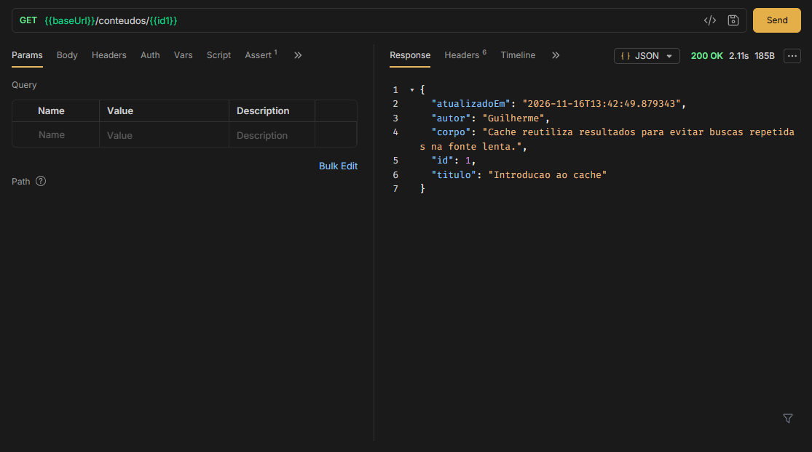
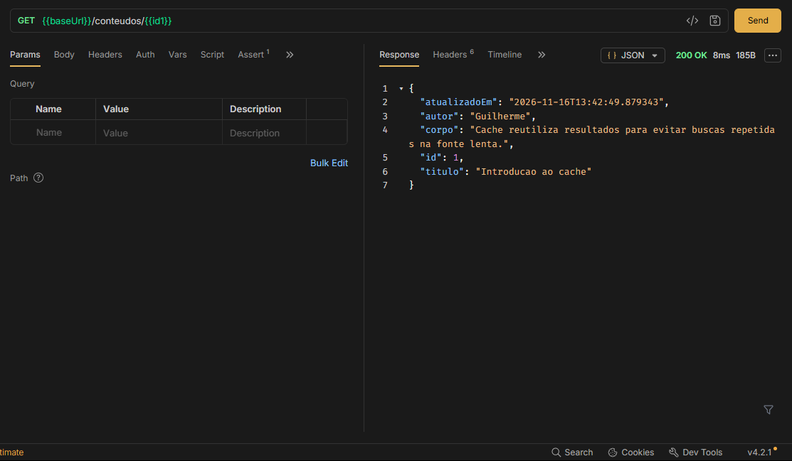
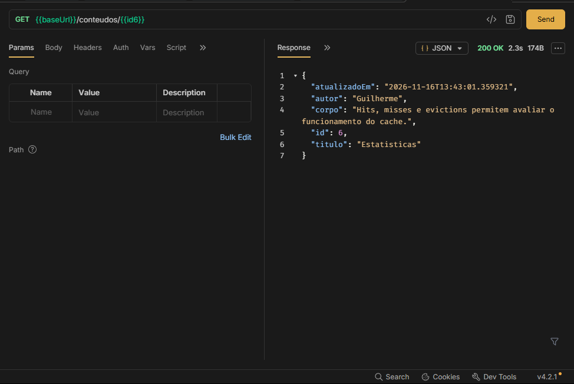
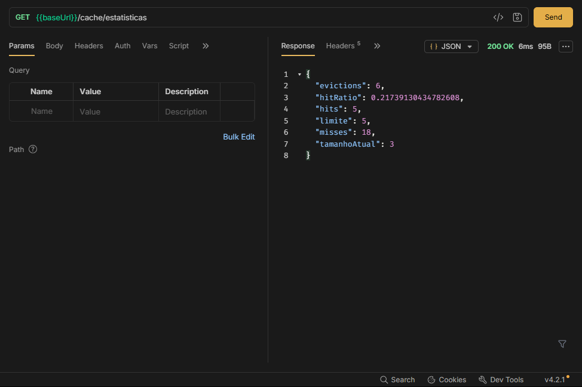
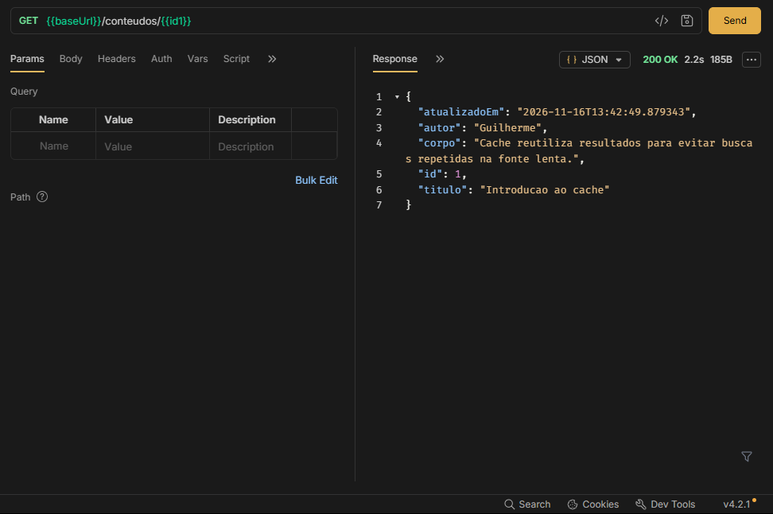
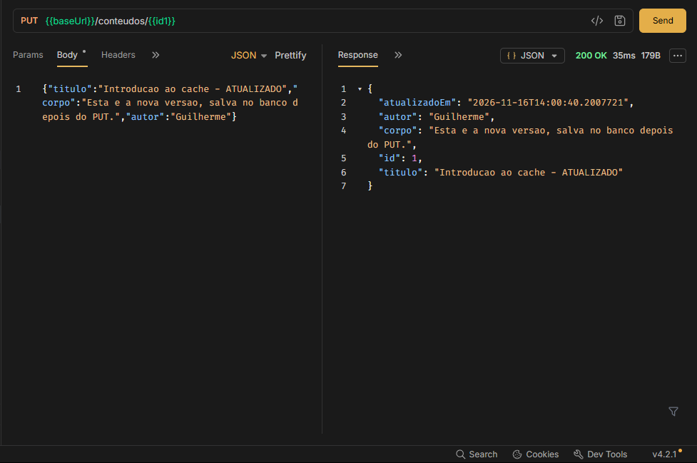
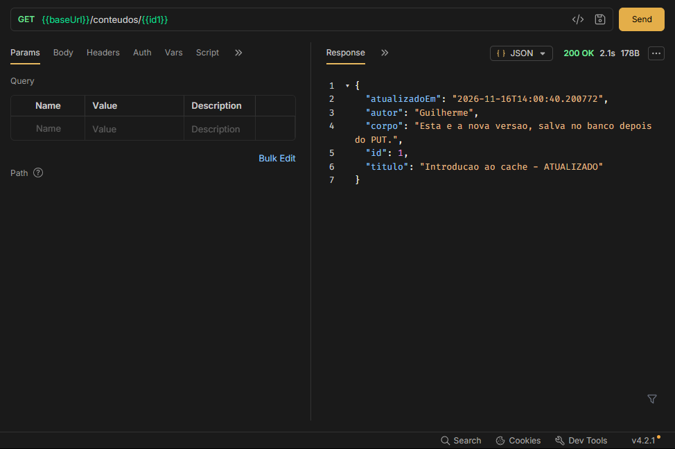

# Atividade-Cache

API de conteúdos feita com Java 21 e Spring Boot 4.1.2. Os conteúdos ficam no
banco H2, e um cache local evita repetir buscas na fonte. A busca no banco tem
um atraso artificial de dois segundos para facilitar a comparação entre HIT e MISS.

O cache foi implementado com `ConcurrentHashMap`, sem bibliotecas de cache.

## Como rodar

É necessário ter o **JDK 21** e o **Maven** instalados, com o Java disponível no
terminal. Também é possível usar o Maven Wrapper incluído no projeto.

Na pasta do projeto, execute no PowerShell:

```powershell
mvn spring-boot:run
```

Se não tiver Maven instalado, use o Wrapper. Na primeira execução ele precisa de
internet para baixar o Maven e as dependências:

```powershell
.\mvnw.cmd spring-boot:run
```

A API ficará em **http://localhost:8080**. Use Bruno, Postman ou Insomnia para
enviar as requisições. Para encerrar, pressione `Ctrl+C` no terminal.

Outros comandos:

```powershell
# Executar os testes existentes
mvn test

# Gerar o JAR
mvn package

# Executar o JAR gerado
java -jar .\target\Hash-Cache-0.0.1-SNAPSHOT.jar
```

O H2 está configurado em memória. **Ao reiniciar a aplicação, os conteúdos,
as entradas do cache e as estatísticas são perdidos.** Não é necessário instalar
um banco separado.

Para consultar as tabelas, abra http://localhost:8080/h2-console com a aplicação
em execução:

| Campo | Valor |
| --- | --- |
| JDBC URL | `jdbc:h2:mem:conteudos;DB_CLOSE_DELAY=-1` |
| Usuário | `sa` |
| Senha | Deixar em branco |

## Configuração

As propriedades ficam em
[`src/main/resources/application.properties`](src/main/resources/application.properties):

```properties
app.fonte.atraso-milissegundos=2000
app.cache.max-itens=5
app.cache.ttl-segundos=60
```

- **Atraso:** aplicado apenas quando a busca precisa consultar a fonte.
- **Limite:** no máximo cinco conteúdos no cache.
- **TTL:** validade de 60 segundos contados desde a entrada no cache.

Após alterar o arquivo, reinicie a aplicação. O limite e o TTL devem ser maiores
que zero; o atraso pode ser zero.

## Endpoints

Todas as rotas abaixo usam a base `http://localhost:8080`.

| Método | Rota | Comportamento |
| --- | --- | --- |
| `POST` | `/conteudos` | Cadastra e retorna `201`, com o conteúdo e o header `Location`. |
| `GET` | `/conteudos/{id}` | Busca e retorna `200`, com o header `X-Cache: HIT` ou `X-Cache: MISS`. |
| `PUT` | `/conteudos/{id}` | Atualiza e retorna `200`; invalida a entrada após o commit. |
| `DELETE` | `/conteudos/{id}` | Exclui e retorna `204`; invalida a entrada após o commit. |
| `GET` | `/cache/estatisticas` | Retorna tamanho, limite e contadores do cache. |
| `DELETE` | `/cache` | Limpa as entradas e retorna `204`, sem apagar o banco ou zerar os contadores. |

No `POST` e no `PUT`, selecione corpo JSON e envie o header
`Content-Type: application/json`. Exemplo de corpo:

```json
{
  "titulo": "Introdução ao cache",
  "corpo": "Cache reutiliza resultados para evitar buscas repetidas na fonte lenta.",
  "autor": "Guilherme"
}
```

A resposta inclui os campos enviados, o `id` gerado e `atualizadoEm`. Use esse ID
nas próximas requisições. O cadastro não coloca o conteúdo no cache: isso acontece
na primeira busca.

Os três campos são obrigatórios e não aceitam apenas espaços. Título e autor têm
limite de 255 caracteres. Dados inválidos retornam `400`; buscar, atualizar ou
excluir um ID inexistente retorna `404`.

## Como o cache funciona

### Caminho da busca

```text
GET /conteudos/{id}
		|
	Controller -> Service -> Cache
							  |
							  +-- Entrada válida: HIT -> devolve o conteúdo
							  |
							  +-- Ausente ou expirada: MISS
									  |
								 Espera 2 segundos
									  |
								 Consulta o banco
									  |
								 Guarda no cache e devolve
```

A controller converte os DTOs usando o mapper. O service recebe e retorna
entidades e é quem utiliza o cache. O repositório faz o acesso ao banco.

Cada entrada do mapa usa o ID como chave e guarda:

- O conteúdo encontrado.
- O momento em que foi armazenado, usado para verificar o TTL.
- O último acesso, usado para escolher quem sai quando falta espaço.

### TTL: expiração por tempo

Uma entrada armazenada às 10:00:00 expira às 10:01:00 com a configuração atual.
Um acesso às 10:00:40 não renova o TTL, apenas atualiza o último acesso.

Uma busca por uma entrada vencida é MISS e consulta novamente o banco. Entradas
expiradas também são removidas antes de inserir um conteúdo e ao consultar as
estatísticas. Não há rotina agendada de limpeza.

### LRU: remoção por limite

Se as cinco vagas estiverem ocupadas por entradas válidas, inserir outro conteúdo
remove aquele que está há mais tempo sem ser acessado. Essa política se chama
**LRU — Least Recently Used**.

Por exemplo: buscar 1, 2, 3, 4 e 5 preenche o cache. Buscar o 1 novamente o torna
mais recente. Ao buscar o 6, quem sai é o **2**. A remoção afeta apenas o cache;
o conteúdo continua no banco.

### Invalidação após alterações

O `PUT` salva os dados no banco e remove a cópia do cache após a confirmação da
transação, chamada de commit. O próximo GET é MISS e carrega a versão nova.

O `DELETE` também invalida a cópia após o commit. Nesse caso, o próximo GET retorna
`404`, pois o conteúdo não existe mais no banco.

### Concorrência e logs

O armazenamento usa `ConcurrentHashMap`. Uma trava com `synchronized` protege
operações compostas, como verificar o limite, escolher uma entrada e inserir outra.
Os contadores também são acessados sob essa trava.

A trava inclui a busca lenta, então uma requisição pode fazer outras aguardarem.
É uma limitação desta implementação local, não uma solução para alta escala.

As buscas geram logs SLF4J com resultado, ID e duração. Exemplos ilustrativos:

```text
Cache MISS - id=1 - 2015 ms
Cache HIT - id=1 - 1 ms
Cache LRU - id=2 - limite=5
Cache TTL - id=1 - entrada expirada
Cache INVALIDADO - id=1
```

O tempo do log mede a operação do cache, incluindo a fonte em um MISS. O cliente
HTTP também mede o restante da requisição; por isso, os tempos podem diferir.

### Estatísticas

Consulte `GET /cache/estatisticas`:

| Campo | Significado |
| --- | --- |
| `tamanhoAtual` | Quantidade de entradas não expiradas no momento da consulta. |
| `limite` | Máximo de entradas configurado. |
| `hits` | Buscas atendidas por uma entrada válida. |
| `misses` | Buscas sem entrada válida, inclusive quando o banco retorna que o ID não existe. |
| `evictions` | Remoções por falta de espaço. TTL, invalidação e limpeza manual não contam aqui. |
| `hitRatio` | `hits / (hits + misses)`. Sem buscas, retorna zero. |

Um `hitRatio` de `0.8` representa 80%. Os contadores acumulam durante a execução;
`DELETE /cache` não os zera. Para começar uma demonstração com contadores zerados,
reinicie a aplicação e cadastre os conteúdos novamente.

## Demonstração com os prints

As nove capturas abaixo estão em [`docs/prints`](prints). Os tempos citados
são os exibidos pelo cliente HTTP, não valores fixos da aplicação.

As imagens registram respostas, tempos e estatísticas. Elas não exibem os headers
`X-Cache` nem os logs do terminal. Para confirmar a causa de cada MISS, confira
também esses dados durante a execução; uma resposta lenta, sozinha, não distingue
expiração, remoção por limite ou invalidação.

### 1. Primeira busca lenta e segunda busca rápida

Cadastre pelo menos sete conteúdos com `POST /conteudos`, mudando os títulos e
guardando os IDs retornados. Em uma execução nova, os IDs usados no exemplo são
de 1 a 7. Depois faça `GET /conteudos/1` duas vezes seguidas.

Na primeira busca, a captura mostra **2,11 segundos**. O esperado é
`X-Cache: MISS`, pois o conteúdo ainda não estava no cache.



Na segunda busca, a captura mostra **8 ms**. Executada antes de expirar o TTL, a
mesma consulta deve retornar `X-Cache: HIT`.



### 2. Limite de cinco itens e remoção LRU

Para repetir este cenário sem depender das buscas anteriores:

1. Envie `DELETE /cache`.
2. Busque os conteúdos 1, 2, 3, 4 e 5, nessa ordem.
3. Busque o 1 novamente para atualizar seu último acesso.
4. Busque o 6. A entrada do 2 deve sair; confira `Cache LRU - id=2` no terminal.
5. Busque o 2 novamente. Será MISS porque ele saiu do cache.
6. Consulte `GET /cache/estatisticas`.

Execute essa sequência antes de vencer o TTL de 60 segundos. Se uma entrada já
tiver expirado, haverá espaço livre e a remoção LRU pode não ocorrer.

A captura seguinte registra a busca pelo conteúdo 6 no cenário de cache cheio:



Esta registra a nova busca pelo conteúdo 2:


As estatísticas mostram o limite e o contador de remoções por capacidade. Os
valores acumulados dependem de todas as buscas feitas desde a inicialização:



### 3. Expiração pelo TTL

Envie `DELETE /cache`, busque o conteúdo 1 e repita a busca para confirmar HIT.
Espere **61 segundos**, sem limpar o cache nem alterar o conteúdo, e busque o 1
outra vez. O esperado é `X-Cache: MISS` e o log `Cache TTL - id=1`.

A imagem registra a busca lenta no cenário de TTL. A espera e o evento de
expiração precisam ser conferidos na sequência de execução e no terminal:



### 4. Atualização e invalidação

Com o conteúdo 1 no cache e ainda válido, envie `PUT /conteudos/1`, mantendo os
três campos obrigatórios e alterando o título e o corpo. Confira o log
`Cache INVALIDADO - id=1` após a atualização.

A resposta do PUT mostra o título **Introducao ao cache - ATUALIZADO**:



Em seguida, envie `GET /conteudos/1`. Ele deve retornar `X-Cache: MISS`, passando
pela fonte lenta e trazendo o texto novo. A captura mostra o conteúdo atualizado
e a resposta em aproximadamente **2,1 segundos**:



### 5. Estatísticas ao final

Envie `GET /cache/estatisticas` depois dos cenários. A captura registra o resultado
acumulado da demonstração. Ao repetir os testes, os números podem mudar conforme
a quantidade de requisições e o tempo entre elas.


Para complementar as evidências, capture a aba de headers com `X-Cache` e o terminal
com os logs de HIT/MISS, LRU, TTL e invalidação. Essas capturas de logs não estão
entre as nove imagens atuais.

## Pesquisa

O documento da Parte 1 está em [`docs/pesquisa-cache.pdf`](pesquisa-cache.pdf).
